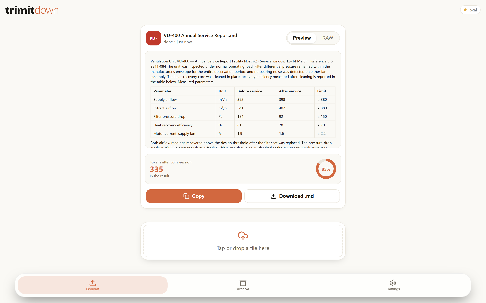
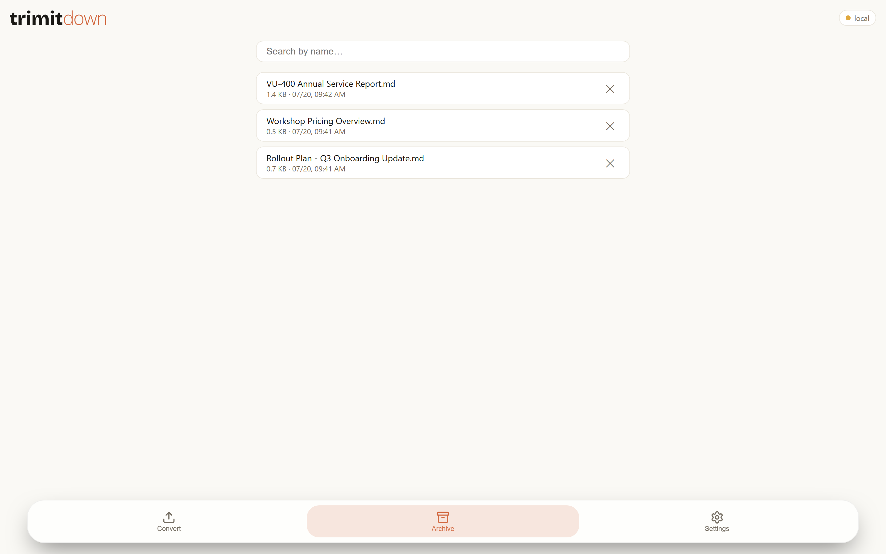
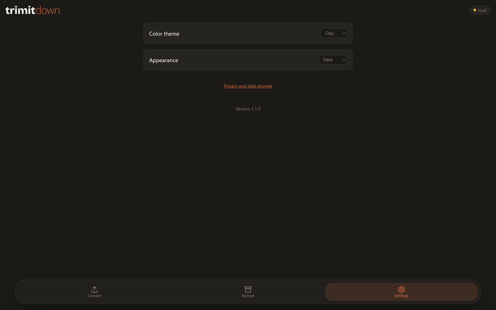
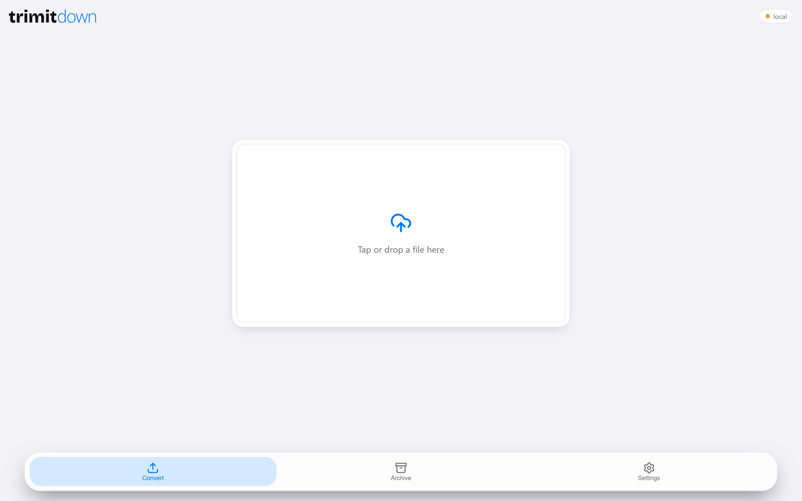
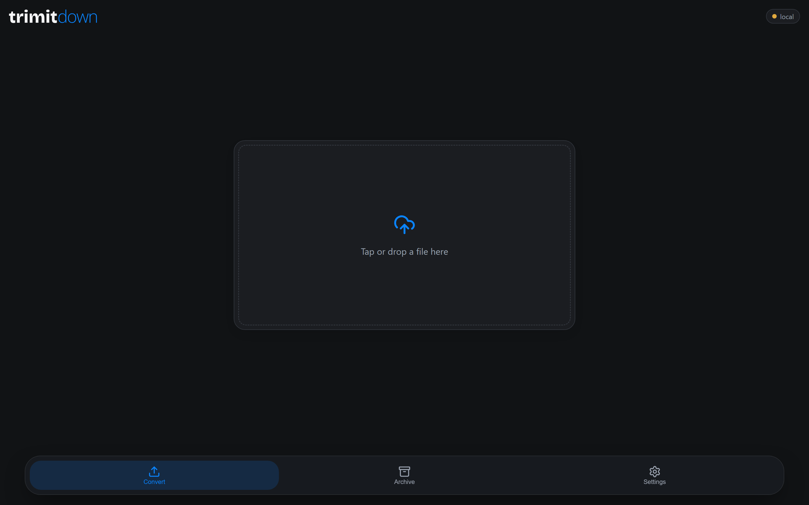
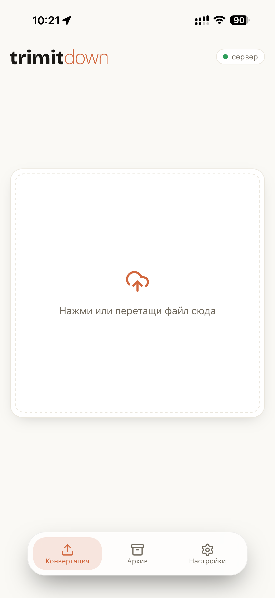
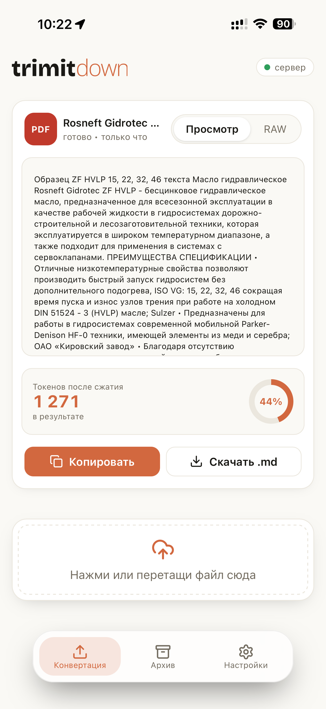

<div align="center">

<picture>
  <source media="(prefers-color-scheme: dark)" srcset="brand/wordmark_dark.svg">
  
</picture>

**Любой документ → чистый Markdown, готовый для LLM. На вашем сервере, на всех ваших устройствах.**

*Читать на: [English](README.md) · русском (этот файл)*

[](https://github.com/serjdrej/trimitdown/releases/latest)
[](https://github.com/serjdrej/trimitdown/releases)
[](https://github.com/serjdrej/trimitdown/actions/workflows/build-macos.yml)
[](https://pypi.org/project/trimitdown/)
[](LICENSE)


<picture>
  <source media="(prefers-color-scheme: dark)" srcset="docs/images/result-dark.png">
  
</picture>

</div>

TrimItDown превращает PDF, Word (docx), PowerPoint (pptx), Excel (xlsx/xls) и письма Outlook
(.msg) в чистый, читаемый Markdown — чтобы вставить в Claude/ChatGPT, Obsidian, Notion или
любую markdown-базу. Работает как приложение для iPhone/iPad (устанавливается прямо из Safari,
без App Store), программа для Windows одним файлом, приложение для macOS и self-hosted
Docker-сервер — с одним общим архивом конвертаций на всех устройствах.

## PDF-движок

Большинство конвертеров — включая стандартный PDF-путь
[MarkItDown](https://github.com/microsoft/markitdown) — спотыкаются на реальных PDF тремя
измеримыми способами: **слепляют слова**, **выдумывают таблицы из обычного текста** и
**теряют настоящие таблицы с разлиновкой**. На 891 реальном документе из двух независимых
коллекций стандартный конвертер выдал 5 624 строки таблиц на документах, где разлиновки нет
вообще, — обычный текст, перекроенный в таблицы, — против 2 строк у движка ниже. Склейки слов
он сокращает примерно вдвое на тех 885 документах, что не сломаны в источнике (107 против
53). Сами корпуса — сторонние копирайтные документы,
распространять их нельзя; полная методика, цифры, случаи, где движок **проигрывает**, и то,
что читатель **может** воспроизвести сам, — в [docs/pdf-engine.md](docs/pdf-engine.md).

Поэтому мы заменили его собственным движком извлечения:

- **Слова разбиваются по измеренному порогу межсловного интервала** — доля от размера шрифта,
  а не фиксированные пункты, поэтому работает и для мелкого кегля, и для крупных заголовков.
- **Отдельная стадия детекции таблиц** проверяет каждую сетку-кандидата по тому, как реально
  заполнены её ячейки (голосование по заполненности строк), вместо того чтобы верить каждому
  разлинованному прямоугольнику. Диаграммы и декоративные рамки отбрасываются, а их текст
  возвращается в прозу, не пропадая.
- **Настоящие разлинованные таблицы рендерятся честными Markdown-таблицами**, ячейка в ячейку.

Вот один документ, сконвертированный обоими способами. Файл лежит в репозитории, так что
сравнение можно запустить самому:

```bash
python scripts/compare_pdf_engines.py tests/data/sample-service-report.pdf
```

**Стандартный конвертер** — фантомная пустая колонка разрывает данные, и каждое значение
уезжает на колонку правее своего заголовка:

```markdown
| Parameter                 | Unit | Before service |     | After service | Limit |
| ------------------------- | ---- | -------------- | --- | ------------- | ----- |
| Supply airflow            | m³/h |                | 352 | 398           | ≥ 380 |
| Extract airflow           | m³/h |                | 341 | 402           | ≥ 380 |
| Filter pressure drop      | Pa   |                | 184 | 92            | ≤ 150 |
| Heat recovery efficiency  | %    |                | 61  | 78            | ≥ 70  |
| Motor current, supply fan | A    |                | 1.9 | 1.6           | ≤ 2.2 |
```

**TrimItDown** — таблица такая же, как на странице:

```markdown
| Parameter | Unit | Before service | After service | Limit |
| --- | --- | --- | --- | --- |
| Supply airflow | m³/h | 352 | 398 | ≥ 380 |
| Extract airflow | m³/h | 341 | 402 | ≥ 380 |
| Filter pressure drop | Pa | 184 | 92 | ≤ 150 |
| Heat recovery efficiency | % | 61 | 78 | ≥ 70 |
| Motor current, supply fan | A | 1.9 | 1.6 | ≤ 2.2 |
```

Один пример ничего не доказывает про корпус, а наш корпус — чужие документы, публиковать их
нельзя. Поэтому вместо документов мы выкладываем само измерение: направьте его на свои PDF, и
оно прогонит по ним оба конвертера и напечатает сопоставимую сводку — только числа, без имён
файлов:

```bash
python scripts/measure_corpus.py /путь/к/вашим/pdf --limit 50
```

**Пришлите эту сводку в любом случае** — выигрыш, проигрыш или ничья
([шаблон issue](https://github.com/serjdrej/trimitdown/issues/new?template=measurement.yml)).
Данные, собранные только когда что-то сломалось, — это выборка из поломок, честного вывода из
неё не сделать. А сложенные вместе по достаточному числу корпусов, эти числа перестают быть
одной чьей-то подборкой. Подробности:
[docs/pdf-engine.md](docs/pdf-engine.md#re-measuring-on-your-own-pdfs).

Коротко: мы добавляем стадию *валидации* таблиц, которая есть в классическом конвейере
tabula-java и которой не хватает Python-экстракторам, — в виде голосования по заполненности
ячеек на разлинованных сетках pdfplumber, с фолбэком в прозу для каждой отдельной сетки. Без
ML-моделей, без облака, достаточно компактно, чтобы уместиться в портативный бинарник. Все
остальные форматы по-прежнему идут через MarkItDown.

## Зачем это нужно

- **Сделано под работу с LLM.** На выходе чистый Markdown, живой предпросмотр и счётчик
  токенов — видно, сколько документ «стоит», ещё до вставки в контекст модели.
- **Файлы не покидают вашу инфраструктуру.** Конвертация — на вашем собственном сервере
  (домашний NAS, VPS) или полностью офлайн на компьютере. Без стороннего SaaS, без платы
  за страницы.
- **Один архив на все устройства.** Конвертировали на телефоне — результат уже на компьютере,
  и наоборот. С поиском, батч-конвертацией и выгрузкой в ZIP.
- **Настоящее приложение на каждой платформе.** iPhone PWA из Safari (без App Store),
  exe для Windows одним файлом, приложение для macOS. Интерфейс на русском и английском,
  светлая/тёмная тема, две цветовые схемы.

## Как получить

| Платформа | Как |
|---|---|
| **Терминал** (любая ОС) | `uv tool install trimitdown` — без GUI и без подтверждений системы, см. [Пакет командной строки](#пакет-командной-строки) |
| **Windows** | Только x64: `scoop bucket add trimitdown https://github.com/serjdrej/trimitdown`, затем `scoop install trimitdown` — ярлык в меню «Пуск», дальше `scoop update trimitdown`. Либо скачать `TrimItDown-windows-x64.exe` из [Releases](https://github.com/serjdrej/trimitdown/releases/latest) — один файл, без установщика |
| **macOS 11+** | Из [Releases](https://github.com/serjdrej/trimitdown/releases/latest): Apple Silicon (M1 и новее) → `TrimItDown-macOS-arm64.dmg`; Intel Mac → `TrimItDown-macOS-x86_64.dmg`. Смонтировать, перетащить TrimItDown в Applications, затем [Первый запуск](#первый-запуск) |
| **iPhone / iPad** | Отдаётся вашим Docker-сервером — открыть в Safari → «Поделиться» → *На экран «Домой»* |
| **Docker-сервер** | См. [Свой сервер](#свой-сервер) ниже |

Десктоп-приложения из коробки работают полностью офлайн. Чтобы получить общий архив, укажите
адрес сервера на экране **Настройки**.

### Первый запуск

Приложения не подписаны сертификатом разработчика, поэтому каждая система один
раз спрашивает разрешение на запуск незнакомой программы. Это происходит один
раз на скачанную копию, а не при каждом запуске.

- **macOS** — первый запуск отклоняется; закрыть предупреждение, разрешить
  приложение в **Системные настройки → «Конфиденциальность и безопасность» →
  «Всё равно открыть»**, запустить снова.
- **Windows** — SmartScreen → **«Подробнее» → «Выполнить в любом случае»**.
  При установке через scoop этого запроса нет вовсе: scoop не помечает
  скачанное как пришедшее из интернета, и предупреждать SmartScreen не о чем.

Бинарники не подписаны. Workflow `release.yml` создаёт `SHA256SUMS` для каждого десктопного артефакта:
хеш проверяет целостность скачанного файла, но не подтверждает издателя. Если в релизе есть
`SHA256SUMS`, сравните хеш скачанного файла со строкой для его имени:

```powershell
Get-FileHash .\TrimItDown-windows-x64.exe -Algorithm SHA256
```

```bash
shasum -a 256 TrimItDown-macOS-arm64.dmg
```

## Пакет командной строки

Требуется Python 3.10+. Постоянная установка — `uv tool install trimitdown`, либо
`pipx install trimitdown`. Прямой `pip install` в системный Python на многих дистрибутивах и в
Homebrew отклоняется (PEP 668), поэтому оба варианта выше ставят пакет в изолированное окружение.
Пакет — `trimitdown`; `trimitdown-pdf` — его зависимость и отдельно конечному пользователю не нужен.

```bash
trimitdown convert report.pdf -o report.md
```

Без `-o` Markdown уходит в стандартный вывод; вход можно подать потоком:
`trimitdown convert - --type pdf`. CLI полностью работает офлайн.

Попробовать разово, не устанавливая: `uvx trimitdown convert report.pdf`. Постоянная команда
`trimitdown` при этом не создаётся, но скачанные пакеты и окружения могут остаться в кеше uv.

Обновить установленный CLI: `uv tool upgrade trimitdown` или `pipx upgrade trimitdown`; удалить:
`uv tool uninstall trimitdown` или `pipx uninstall trimitdown`.

## Свой сервер

Docker-сервер — источник истины: он конвертирует, хранит общий архив и отдаёт PWA для iPhone.
Этот репозиторий не публикует готовый Docker-образ: команды ниже собирают выбранный релиз из
исходников. Нужны Git, Docker с Compose и OpenSSL. Перед сборкой выберите тег релиза на странице
Releases, а не собирайте `main`. Клонируйте в отдельный каталог, не внутрь существующего клона,
иначе получится вложенный `trimitdown/docker-server/trimitdown/docker-server`.

```bash
git clone https://github.com/serjdrej/trimitdown.git && cd trimitdown && git checkout <release-tag> && cd docker-server
./setup.sh ВАШ_АДРЕС_СЕРВЕРА
docker compose up -d --build      # Compose v1: docker-compose up -d --build
```

`setup.sh` печатает ссылку для первого входа; секрет переедет в cookie, и дальше достаточно
`https://ВАШ_СЕРВЕР:8002`.

Один общий секрет, а не учётные записи: сервер хранит один архив и принадлежит одному
человеку. Без секрета он отказывается обслуживать запросы. `docker compose` публикует порт
на всех интерфейсах, а собственные правила Docker означают, что `ufw deny` на хосте его
**не закрывает** — если нужен доступ только с этой машины, привяжите к `127.0.0.1` в
`docker-compose.yaml`.

Полная инструкция — генерация сертификата, доверие к нему на iOS/Windows/macOS и API —
в [`docker-server/README.md`](docker-server/README.md).

## Удаление

Удаление программы или контейнера не удаляет пользовательские документы автоматически.

| Канал | Как удалить программу | Что останется |
|---|---|---|
| `uv tool` | `uv tool uninstall trimitdown` | Созданные Markdown-файлы и кеш пакетов uv |
| `pipx` | `pipx uninstall trimitdown` | Созданные Markdown-файлы и кеши pip/pipx |
| Scoop | `scoop uninstall trimitdown`; при необходимости `scoop bucket rm trimitdown` | `%APPDATA%\TrimItDown` |
| Windows EXE | Удалить скачанный EXE | `%APPDATA%\TrimItDown` |
| macOS DMG | Удалить `TrimItDown.app` из Applications | `~/Library/Application Support/TrimItDown` |
| Docker | В `docker-server/`: `docker compose down` | Образ `trimitdown-web:latest`, клон, `.env`, `certs/` и `archive/` |
| iPhone/iPad PWA | Удалить с экрана «Домой» | Данные сайта Safari, cookie и установленный сертификат |

Перед удалением `archive` сохраните нужные конвертации: удаление приложения или контейнера само
по себе этот каталог не очищает. Доверие к сертификату — системное состояние: удаление приложения
или PWA его не отменяет. Если серверу больше не доверяете, удалите профиль на iOS, сертификат из
`CurrentUser\Root` на Windows или сертификат из Keychain на macOS.

## Скриншоты

| Архив, общий между устройствами | Настройки |
|---|---|
|  |  |

| Тема «океан», светлая | Тема «океан», тёмная |
|---|---|
|  |  |

| PWA на iPhone — главный экран | Конвертация PDF |
|---|---|
|  |  |

## Как это работает

- **Docker-сервер** — сервис на FastAPI с HTTPS; архив хранится на сервере. Тот же сервис
  отдаёт PWA для iPhone.
- **Приложения для Windows/macOS** при старте проверяют доступность сервера: доступен —
  открываются прямо на нём (общий архив); нет — поднимают встроенный локальный сервер и
  работают полностью офлайн. Оболочка — [pywebview](https://pywebview.flowrl.com/)
  (WebView2 / WKWebView), упаковка — PyInstaller.
- **Конвертация:** PDF идут через собственный движок TrimItDown
  ([`trimitdown-pdf`](packages/trimitdown-pdf), построен на pdfplumber); все остальные
  форматы — через [MarkItDown](https://github.com/microsoft/markitdown) от Microsoft.

## Структура репозитория

- [`src/trimitdown/`](src/trimitdown/) — публикуемый CLI-пакет и логика конвертации
- [`core/`](core/) — HTTP-слой и работа с архивом для десктопного приложения и сервера
- [`packages/trimitdown-pdf/`](packages/trimitdown-pdf/) — отдельно публикуемый PDF-движок
- [`docker-server/`](docker-server/) — self-hosted сервис + PWA для iPhone
- [`static/`](static/), [`main.py`](main.py), [`server_app.py`](server_app.py) — десктоп-приложения (UI, точка входа, офлайн-режим)
- [`tests/`](tests/) — юнит-тесты + размеченный корпус для стадии детекции таблиц
- [`docs/pdf-engine.md`](docs/pdf-engine.md) — устройство PDF-движка, измерения, воспроизведение

## Участие в разработке

Баг-репорты и PR приветствуются — см. [CONTRIBUTING.md](CONTRIBUTING.md).
В [DEVELOPMENT.md](DEVELOPMENT.md) — настройка dev-окружения и устройство десктоп-сборки.

## Ограничения

- Лучший вариант — PDF с текстовым слоем и таблицами с разлиновкой. Таблицы без границ и таблицы,
  выровненные пробелами, вне области работы PDF-движка.
- TrimItDown не делает OCR. Сканированные страницы и PDF только с изображением помечаются как не
  имеющие извлекаемого текстового слоя.
- Полное восстановление многоколонной вёрстки не поддерживается: в том числе порядок чтения между
  колонками, колонтитулы и подписи к рисункам.
- Самоподписанный HTTPS-сертификат сервера нужно один раз вручную одобрить на каждом
  устройстве (iOS: профиль + полное доверие; Windows: импорт в `CurrentUser\Root`;
  macOS: Keychain).
- Бинарники не подписаны: одно ручное подтверждение на скачанную копию — см.
  [Первый запуск](#первый-запуск).

## Лицензия и благодарности

Код — под лицензией [MIT](LICENSE). Конвертация не-PDF форматов — на
[MarkItDown](https://github.com/microsoft/markitdown) (Microsoft, MIT); лицензии встроенных
сторонних компонентов перечислены в [THIRD_PARTY_NOTICES.md](THIRD_PARTY_NOTICES.md).
